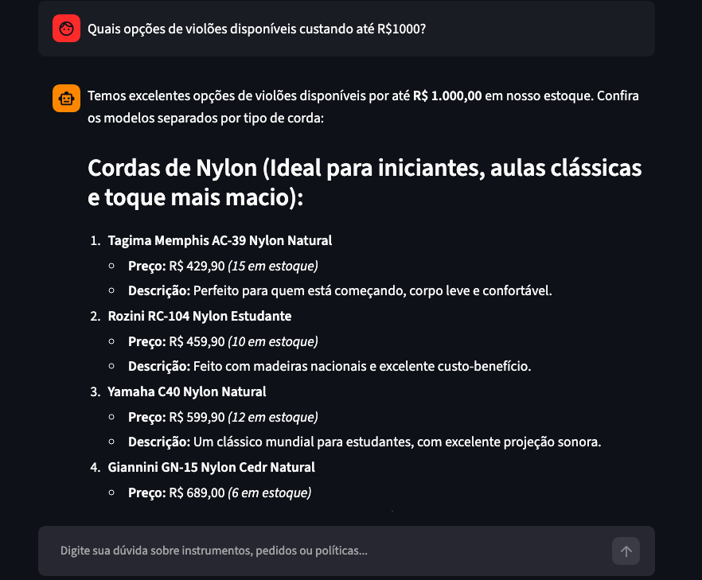

# Example 1: Product Catalog Lookup with Price Filtering

**User Query:**

> Quais opções de violões disponíveis custando até R$1000?

**Agent Action (Tool Execution):**
`consultar_banco_dados(query="SELECT p.name, p.price_brl, p.stock_quantity, p.description, c.name as categoria FROM products p JOIN categories c ON p.category_id = c.category_id WHERE (p.name ILIKE '%violao%' OR c.name ILIKE '%violao%' OR p.description ILIKE '%violao%') AND p.price_brl <= 1000 AND p.stock_quantity > 0")`

**Agent Response:**

> Temos excelentes opções de violões disponíveis por até R$ 1.000,00 em nosso estoque. Confira os modelos separados por tipo de corda:
>
> Cordas de Nylon (Ideal para iniciantes, aulas clássicas e toque mais macio):
>
> 1. Tagima Memphis AC-39 Nylon Natural
>
> - Preço: R$ 429,90 (15 em estoque)
> - Descrição: Perfeito para quem está começando, corpo leve e confortável.
>
> 2. Rozini RC-104 Nylon Estudante
>
> - Preço: R$ 459,90 (10 em estoque)
> - Descrição: Feito com madeiras nacionais e excelente custo-benefício.
>
> 3. Yamaha C40 Nylon Natural
>
> - Preço: R$ 599,90 (12 em estoque)
> - Descrição: Um clássico mundial para estudantes, com excelente projeção sonora.
>
> 4. Giannini GN-15 Nylon Cedr Natural
>
> - Preço: R$ 689,00 (6 em estoque)
> - Descrição: Sonoridade quente e encorpada, ótimo para estudantes um pouco mais avançados.
>
> 5. Yamaha C70 Nylon Natural
>
> - Preço: R$ 849,00 (8 em estoque)
> - Descrição: Modelo de nível intermediário com tampo em Spruce sólido e acabamento de alta qualidade.
>
> Cordas de Aço (Ideal para acompanhamentos, pop, rock, sertanejo e som mais brilhante):
>
> 1. Shelby SN-100 Folk Aço Preto
>
> - Preço: R$ 549,00 (5 em estoque)
> - Descrição: Visual moderno em preto, versátil e com boa relação custo-benefício.
>
> 2. Giannini GF-1R Aço Folk Sunburst
>
> - Preço: R$ 579,90 (7 em estoque)
> - Descrição: Visual elegante com acabamento Sunburst e som equilibrado.
>
> 3. Yamaha F310 Aço Natural
>
> - Preço: R$ 699,90 (14 em estoque)
> - Descrição: Um dos violões folk mais vendidos do mundo, robusto e de timbre encorpado.
>
> 4. Tagima Dallas Tuner Aço Natural
>
> - Preço: R$ 749,00 (9 em estoque)
> - Descrição: Acompanha afinador integrado e proporciona um som brilhante.
>
> 5. Tagima Woodstock Dreadnought Natural
>
> - Preço: R$ 899,00 (11 em estoque)
> - Descrição: Corpo amplo estilo dreadnought, oferecendo um som potente e excelente projeção.
>
> Algum desses modelos chamou sua atenção ou gostaria de saber mais detalhes sobre especificações ou formas de pagamento?

---

### Interface Screenshot

