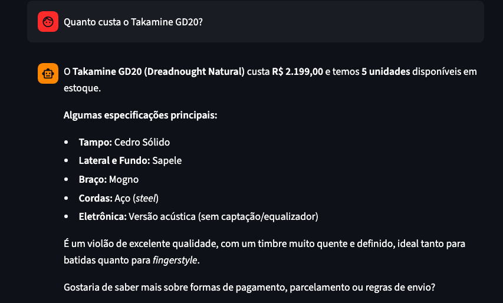

# Example 3: Specific Product Price and Specifications Lookup

**User Query:**

> Quanto custa o Takamine GD20?

**Agent Action (Tool Execution):**
`consultar_banco_dados(query="SELECT name, price_brl, stock_quantity, specs, description FROM products WHERE name ILIKE '%Takamine GD20%'")`

**Agent Response:**

> O Takamine GD20 (Dreadnought Natural) custa R$ 2.199,00 e temos 5 unidades disponíveis em estoque.
>
> Algumas especificações principais:
>
> - Tampo: Cedro Sólido
> - Lateral e Fundo: Sapele
> - Braço: Mogno
> - Cordas: Aço (steel)
> - Eletrônica: Versão acústica (sem captação/equalizador)
>
> É um violão de excelente qualidade, com um timbre muito quente e definido, ideal tanto para batidas quanto para fingerstyle.
>
> Gostaria de saber mais sobre formas de pagamento, parcelamento ou regras de envio?

### Interface Screenshot

