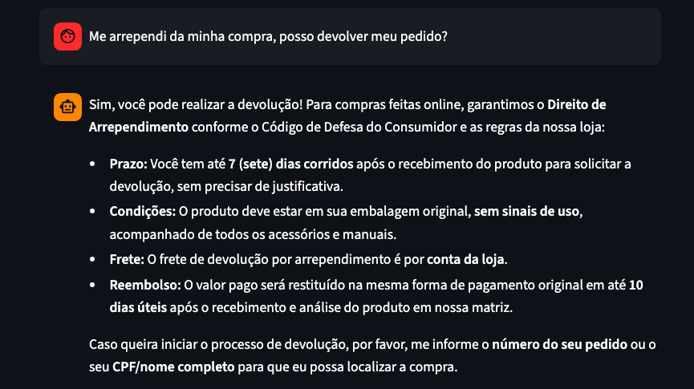

# Example 4: Store Policy Application (Return and Refund)

**User Query:**

> Me arrependi da minha compra, posso devolver meu pedido?

**Agent Action (Tool Execution):**
`consultar_politicas_loja(query="direito de arrependimento devolucao prazo regras reembolso")`

**Agent Response:**

> Sim, você pode realizar a devolução! Para compras feitas online, garantimos o Direito de Arrependimento conforme o Código de Defesa do Consumidor e as regras da nossa loja:
>
> - Prazo: Você tem até 7 (sete) dias corridos após o recebimento do produto para solicitar a devolução, sem precisar de justificativa.
> - Condições: O produto deve estar em sua embalagem original, sem sinais de uso, acompanhado de todos os acessórios e manuais.
> - Frete: O frete de devolução por arrependimento é por conta da loja.
> - Reembolso: O valor pago será restituído na mesma forma de pagamento original em até 10 dias úteis após o recebimento e análise do produto em nossa matriz.
>
> Caso queira iniciar o processo de devolução, por favor, me informe o número do seu pedido ou o seu CPF/nome completo para que eu possa localizar a compra.

### Interface Screenshot

